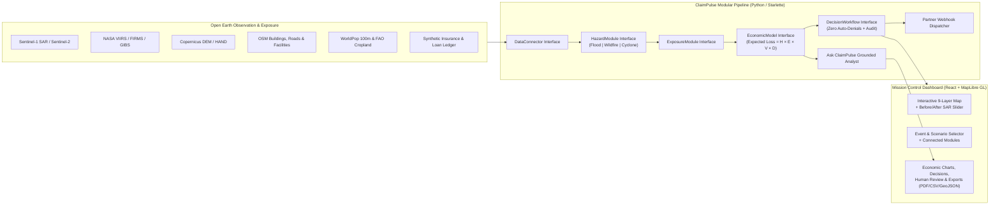

# ClaimPulse — Satellite Disaster Risk & Economic Decision Engine

> **Turn satellite observations of floods, wildfires, and cyclones into fast, explainable economic decisions.**

ClaimPulse bridges the gap between Earth observation pixels and financial action. Instead of stopping at a flood or burn map, ClaimPulse converts satellite-derived hazard footprints into asset-level exposure, transparent economic loss estimates, provisional insurance payouts, government relief priority rankings, and lender collateral risk alerts—complete with human-in-the-loop review and an immutable audit trail.

---

## 1. Problem Statement

After major floods, wildfires, or cyclones, insurers, government relief agencies, banks, and supply-chain operators face an **information-to-liquidity bottleneck**:
- Satellite damage maps exist within hours, yet economic triage and field claims take weeks.
- Vulnerable households wait for emergency relief while parametric or fast-track liquidity remains locked behind manual inspection queues.
- Existing tools rarely connect hazard intensity, exposure value, vulnerability, confidence intervals, and explainable governance in one modular decision system.

**ClaimPulse solves this** by translating open satellite imagery into dollar-denominated, auditable decisions in under 10 seconds.

---

## 2. Architecture



---

## 3. Data Sources & Provenance

| Layer | Dataset | Provider | Spatial Resolution | License |
| :--- | :--- | :--- | :--- | :--- |
| **Flood / Surge Extent** | Copernicus Sentinel-1A/B SAR (IW GRD) | ESA / Copernicus | 10 m | Copernicus Open License |
| **Optical / Thermal / Fire** | NASA VIIRS Flood & FIRMS 375m / Sentinel-2 dNBR | NASA Disasters Portal / ESA | 20 m – 375 m | NASA Open Data |
| **Elevation & Depth** | Copernicus DEM GLO-30 + HAND | ESA / OpenTopography | 30 m | Copernicus DEM License |
| **Buildings & Roads** | OpenStreetMap & Microsoft Footprints | OSM / Microsoft Planetary | Vector (< 1 m) | ODbL / CDLA-Permissive |
| **Population** | WorldPop Constrained Grid | WorldPop / Univ. of Southampton | 100 m | CC BY 4.0 |
| **Farmland / Crops** | FAO Global Land Cover / WorldCover | FAO / ESA | 10 m | CC BY 4.0 |
| **Portfolio & Loans** | Synthetic Demo Underwriting Ledger | ClaimPulse Demo | Policy / Asset | Simulated Demo Data |

> **Governance Note:** All bundled scenarios carry a visible **`Demo data`** badge and provenance timestamps. No satellite-derived estimate is ever treated as an automated legal denial—low-confidence (`< 86%`) or high-value (`> ₹8.82 Cr`) claims automatically route to **Manual review**, **Investigate**, or **Insufficient evidence**.

---

## 4. Quick Setup & Run (Zero Complex Setup)

### Option A: Single-Command Production Run (Recommended for Judges)
The frontend production bundle is pre-built into `frontend/dist` and served directly by the Python backend on port `8000`:

```powershell
# From the repository root:
python -m uvicorn backend.main:app --host 127.0.0.1 --port 8000
```
Then open: **http://127.0.0.1:8000**

### Option B: Developer Hot-Reload Mode
Terminal 1 (Backend API):
```powershell
python -m uvicorn backend.main:app --reload --port 8000
```
Terminal 2 (Frontend Vite Dev Server):
```powershell
cd frontend
npm install
npm run dev
```
Open **http://localhost:5173** (proxies `/api/*` to `:8000`).

---

## 5. Transparent Economic Formula

Every dollar figure shown in ClaimPulse is computed deterministically from:

$$\text{Expected Loss} = \text{Hazard Intensity}_{\text{norm}} \times \text{Exposure Value} \times \text{Vulnerability} \times \text{Damage-Function Multiplier}$$

- **Normalized Hazard Intensity:** Flood `depth(m) / 3.6m`, Wildfire `dNBR / 1.0`, Cyclone `index / 2.2` (bounded `[0.02, 1.0]`).
- **Damage-Function Multiplier:** Tiered by severity (`safe: 0.03`, `low: 0.14`, `medium: 0.28`, `high: 0.44`, `extreme: 0.62`) and sector (`agriculture ×1.12`, `business ×1.08`, `housing ×1.00`, `infrastructure ×0.92`).
- **Business Interruption:** `+32%` of direct commercial physical loss.
- **Uncertainty Range:** `-18%` to `+21%` around the point estimate.

---

## 6. REST API Documentation

All endpoints are served under both `/api/...` and root `/...`:

| Method | Endpoint | Description |
| :--- | :--- | :--- |
| `GET` | `/events` | List cached preset & custom events |
| `POST` | `/events` | Run hazard → exposure → economic → decision pipeline for a preset or custom bbox |
| `GET` | `/events/{id}` | Full event bundle (metadata, damage, exposure, loss, decisions) |
| `GET` | `/events/{id}/damage` | Hazard GeoJSON polygons + severity distribution & dataset provenance |
| `GET` | `/events/{id}/exposure` | Exposed buildings, roads, farmland, population, critical facilities & policies GeoJSON |
| `GET` | `/events/{id}/loss` | Sector loss breakdown, time series, top-10 zones, formula assumptions |
| `GET` | `/events/{id}/decisions` | Insurance triage, relief allocation, lender collateral alerts & audit trail |
| `POST` | `/events/{id}/decisions/{decision_id}/review` | Execute human review (`Approve`, `Escalate`, `Request Field Verification`) + emit webhook |
| `GET` | `/events/{id}/export?format=pdf\|csv\|geojson` | Download 1-page PDF Decision Brief, CSV ledger, or GeoJSON package |
| `POST` | `/events/{id}/ask` | Grounded **Ask ClaimPulse** analyst query with citations & counterfactual depth stress |
| `GET` | `/modules` | List registered partner modules |
| `POST` | `/modules/register` | Register a partner module into the **Connected Modules** sidebar |
| `GET` / `POST` | `/webhooks` | Inspect webhook delivery logs or subscribe a partner webhook URL |

---

## 7. Partner Integration Guide

ClaimPulse is built as an extensible platform with 5 Python interfaces in `backend/core/interfaces.py`:
- `DataConnector` — ingest new satellite, drone, IoT river-gauge, or weather feeds.
- `HazardModule` — add new peril engines (earthquake, landslide, drought).
- `ExposureModule` — plug in regional cadastral, utility, or agricultural grids.
- `EconomicModel` — override valuation curves or business-interruption models.
- `DecisionWorkflowModule` — integrate custom underwriting rules or relief disbursement APIs.

### Example Input Schema (`POST /events`)
```json
{
  "disaster_type": "flood",
  "country": "India",
  "state": "Odisha",
  "district": "Puri & Kendrapara",
  "start_date": "2026-10-18",
  "end_date": "2026-10-26",
  "bbox": {
    "min_lon": 85.72,
    "min_lat": 19.76,
    "max_lon": 86.38,
    "max_lat": 20.24
  },
  "intensity_multiplier": 1.2
}
```

### Example Output Schema (`GET /events/{id}/decisions` excerpt)
```json
{
  "recommended_action_headline": "Release ₹41.09 Cr provisional insurance liquidity (4 fast-track) & allocate ₹363.30 Cr emergency relief across top 10 priority zones.",
  "total_provisional_payout_inr": 410940600.0,
  "overall_confidence": 0.84,
  "claims": [
    {
      "decision_id": "CLM-POL-OD-1041",
      "policy_id": "POL-OD-1041",
      "severity": "extreme",
      "estimated_claim_inr": 58666608.0,
      "confidence": 0.93,
      "recommendation": "Auto-fast-track",
      "calculation_breakdown": "norm_intensity(0.792) × exposure(₹13.41 Cr) × vulnerability(0.88) × dmg_fn(0.694) = ₹5.87 Cr"
    }
  ]
}
```

### Registering a Partner UI Module (`POST /modules/register`)
Another hackathon team can add their module to the **Connected Modules** sidebar without editing ClaimPulse core code:
```json
{
  "name": "HydroNode River Gauges",
  "partner_team": "Team AquaMesh",
  "category": "data_connector",
  "description": "Real-time ultrasonic river depth sensors validating SAR flood boundaries.",
  "layer_id": "hazard_extent",
  "action_label": "Sync Gauge Telemetry",
  "kpis": { "Active Gauges": "18", "Drift": "< 4 cm" },
  "webhook_url": "https://partner-team.example.com/webhooks/claimpulse"
}
```

### Authentication Approach (Production Blueprint)
- **Partner APIs:** Bearer JWT or Partner API Key header (`Authorization: Bearer <token>` / `X-ClaimPulse-Partner-Key`) scoped per organization (`insurer`, `gov_relief`, `lender`).
- **Webhooks:** Outbound payloads signed with `X-ClaimPulse-Signature: sha256=<HMAC>` using the partner's shared secret on `event.processed` and `decision.updated`.

---

## 8. Roadmap

1. **Live Earth Observation Ingestion:** Connect `DemoSatelliteConnector` to Google Earth Engine, NASA Earthdata CMR, and ESA Copernicus Data Space STAC APIs with async Celery/Redis workers.
2. **PostGIS + Parquet Lakehouse:** Persist multi-terabyte building footprints (Overture Maps / Microsoft) and historical peril curves in PostGIS + DuckDB/Parquet.
3. **Parametric Smart-Contract Disbursement:** Trigger instant micro-insurance payouts via UPI/bank rails upon multi-sensor consensus and human sign-off.
4. **Multi-Peril Cascading Risk:** Chain Cyclone → Storm Surge → Grid Outage → Supply-Chain Interruption models via the `PlatformRegistry`.
